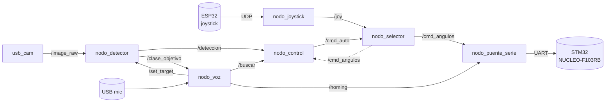

# ros2-pan-tilt-tracker

A ROS 2 pan-tilt camera that finds an object with YOLO and keeps it centered in the frame. You choose what to follow by voice or through a ROS service, and you can take manual control at any time with a wireless joystick.

The system runs on a Raspberry Pi 5 with ROS 2 Jazzy. Motor control is offloaded to an STM32 board running bare-metal firmware, and the joystick is an ESP32 that talks to the Pi over WiFi.

## Features

- **Object detection** with YOLOv8n on the Pi CPU, filtered to a single COCO class that can be changed at runtime.
- **Closed-loop tracking** with an incremental proportional controller that converts pixel error to angle error.
- **Search action** that sweeps the pan axis until the target appears, with feedback and cancellation.
- **Homing** of the pan axis with two limit switches, measuring the real travel and recentering the coordinate system.
- **Smooth stepper motion** generated in firmware with a fixed-point velocity profile and acceleration ramp.
- **Wireless joystick** (ESP32 over UDP) with an automatic/manual mode switch and loss-of-signal handling.
- **Offline voice commands** in Spanish with Vosk and a closed grammar.
- **Hardware enable switch** on the motor board, reported to ROS so the rest of the system knows when the motors are off.

## Architecture



Each node has a single responsibility:

| Node | Role |
|---|---|
| `nodo_detector` | Runs YOLO on every frame and publishes the highest-confidence detection of the target class. Serves `/set_target`. |
| `nodo_control` | Turns the detection error into new pan/tilt angles. Serves the `/buscar` action. |
| `nodo_selector` | Decides who drives the motors: the controller or the joystick, based on the manual switch. |
| `nodo_joystick` | Receives UDP packets from the ESP32 and publishes `sensor_msgs/Joy`. |
| `nodo_puente_serie` | Translates angle commands to the firmware's ASCII protocol, reconnects if the USB drops, and serves `/homing`. |
| `nodo_voz` | Recognizes a fixed vocabulary and calls the corresponding service or action. |

The controller never talks to the motors directly. It publishes on `/cmd_auto`, and the selector forwards it to `/cmd_angulos` only in automatic mode. The controller also listens to `/cmd_angulos`, so when you switch back from manual mode it continues from where the joystick left the camera instead of jumping back.

## ROS interfaces

**Topics**

| Topic | Type | Description |
|---|---|---|
| `/image_raw` | `sensor_msgs/Image` | Camera frames from `usb_cam` |
| `/deteccion` | `vision_msgs/Detection2D` | Best detection of the target class, in pixels |
| `/deteccion/imagen` | `sensor_msgs/Image` | Annotated frame, only rendered when someone subscribes |
| `/clase_objetivo` | `std_msgs/String` | Current target class (transient local) |
| `/cmd_auto` | `std_msgs/Float64MultiArray` | `[pan, tilt]` in degrees from the controller |
| `/cmd_angulos` | `std_msgs/Float64MultiArray` | `[pan, tilt]` in degrees actually sent to the motors |
| `/joy` | `sensor_msgs/Joy` | Joystick axes and manual-mode button |
| `/motores_habilitados` | `std_msgs/Bool` | State of the hardware enable switch (transient local) |

**Services**

| Service | Type | Description |
|---|---|---|
| `/set_target` | `seguidor_interfaces/srv/SetTarget` | Change the class to follow. Rejected if the model doesn't know it |
| `/homing` | `std_srvs/srv/Trigger` | Start pan homing. Returns when homing starts, the result is logged by the bridge |

**Actions**

| Action | Type | Description |
|---|---|---|
| `/buscar` | `seguidor_interfaces/action/Buscar` | Sweep pan to one end and back until the target is detected |

## Hardware

| Part | Used for |
|---|---|
| Raspberry Pi 5 | ROS 2, detection, voice |
| USB camera | Video input, 640×480 MJPEG |
| NUCLEO-F103RB | Motor control firmware, connected over USB (ST-Link virtual COM port) |
| Stepper 17PM-K005 + TB6600 driver | Pan axis, 1/8 microstepping, separate power supply |
| SG90 servo | Tilt axis |
| 2 limit switches | Pan homing and end-of-travel protection |
| Toggle switch | Motor enable |
| ESP32 + analog joystick + switch | Wireless manual control |
| USB microphone | Voice commands |

The pan-tilt mount is 3D printed.

**STM32 pinout**

| Pin | Function |
|---|---|
| PA8 | Stepper `PUL` |
| PB10 | Stepper `DIR` |
| PA6 | Servo PWM (TIM3 CH1, 50 Hz) |
| PA10 | Negative limit switch (`FC_NEG`) |
| PB5 | Positive limit switch (`FC_POS`) |
| PC7 | Enable switch (`HABILITAR`), active low |
| PA2 / PA3 | USART2 to the Pi through the ST-Link USB, 115200 baud |
| PA5 | Status LED (LD2) |

## Firmware

### Serial protocol

One ASCII command per line. Angles are sent as integer tenths of a degree so the firmware never has to parse floats.

| Command | Meaning | Response |
|---|---|---|
| `P<pan> T<tilt>` | Move both axes | `OK P<pan> T<tilt>` with the values actually applied after clamping |
| `H` | Start homing | `HOME START`, then `HOME OK R<range>` or `HOME ERR <reason>` |
| `S` | Request status | `ST POS.. OBJ.. FN.. FP.. BN.. BP.. EN.. HM..` |

Unsolicited messages: `EN0` / `EN1` when the enable switch changes. Moves are rejected with `OFF` while the motors are disabled and with `BUSY` during homing.

### Stepper motion

TIM2 interrupts at 2 kHz and generates the step pulses. On every tick the firmware computes a target speed proportional to the remaining distance, limits how fast that speed can grow, and adds it to a phase accumulator in Q16 fixed point. A step is issued every time the accumulator overflows. The result is a motor that accelerates smoothly and slows down on its own as it approaches the target, without floating point in the interrupt.

### Homing

Homing moves slowly toward the negative switch, then toward the positive one, and places zero in the middle of the measured travel. The usable range is reduced by a small margin on each side and reported back to ROS. After homing, every time a limit switch is hit the step count is corrected to the switch's known position, which recovers lost steps.

## Getting started

### Raspberry Pi

The workspace uses [pixi](https://pixi.sh) with the RoboStack channel, so ROS 2 Jazzy and all Python dependencies are installed in an isolated environment without touching the system.

```bash
git clone https://github.com/AlanVignolo/ros2-pan-tilt-tracker.git
cd ros2-pan-tilt-tracker
pixi install
pixi run colcon build
```

Download the Spanish Vosk model into `~/modelos`:

```bash
mkdir -p ~/modelos && cd ~/modelos
wget https://alphacephei.com/vosk/models/vosk-model-small-es-0.42.zip
unzip vosk-model-small-es-0.42.zip
```

The YOLO weights (`yolov8n.pt`) are downloaded automatically on first run.

### STM32

Open `firmware/seguidor_fw` in STM32CubeIDE, build, and flash through the on-board ST-Link.

### ESP32

```bash
cd firmware/joystick_esp32
cp include/secrets.example.h include/secrets.h   # fill in WiFi SSID and password
pio run -t upload
```

The Pi's address is set in `src/main.cpp` (`IP_RASPBERRY`).

## Usage

Start everything:

```bash
pixi run ros2 launch seguidor seguidor.launch.py clase:=person
```

Launch arguments:

| Argument | Default | Description |
|---|---|---|
| `clase` | `banana` | COCO class to follow, in English |
| `ganancia` | `0.6` | Proportional gain. Always pass it with a decimal point |

Run homing, change the target and start a search from another terminal:

```bash
pixi run ros2 service call /homing std_srvs/srv/Trigger
pixi run ros2 service call /set_target seguidor_interfaces/srv/SetTarget "{clase: 'cup'}"
pixi run ros2 action send_goal --feedback /buscar seguidor_interfaces/action/Buscar "{velocidad: 20.0}"
```

Tune the controller live:

```bash
pixi run ros2 param set /nodo_control ganancia 0.4
pixi run ros2 param set /nodo_control zona_muerta 3.0
```

**Voice commands:** say an object (`gato`, `perro`, `persona`, `taza`, `botella`, `celular`, `silla`, `pelota`) to change the target, `buscar` to start a sweep, or `calibrar` to run homing.

## Design notes

- **Latest frame only.** The detector subscribes with `BEST_EFFORT` and depth 1. When inference is slower than the camera, old frames are dropped instead of queued, so the controller always reacts to the most recent image.
- **Late joiners.** `/clase_objetivo` and `/motores_habilitados` use `TRANSIENT_LOCAL` durability, so a node that starts later still receives the current value.
- **Validation in one place.** `/set_target` changes the class by setting the `clase_objetivo` parameter, so the service and `ros2 param set` share the same validation.
- **Stable serial port.** The bridge opens the board through `/dev/serial/by-id/...` instead of `/dev/ttyACM0`, and a watchdog reopens it if the USB is unplugged.
- **Concurrent action.** `nodo_control` uses a `MultiThreadedExecutor` and a reentrant callback group so the search loop keeps running while detection callbacks arrive.
- **Fail-safe joystick.** If UDP packets stop arriving, the joystick node publishes zero axes once so the camera doesn't keep moving on a stale command.

## Repository layout

```
src/
  seguidor/              Python nodes and launch file
  seguidor_interfaces/   SetTarget service and Buscar action
firmware/
  seguidor_fw/           STM32CubeIDE project for the NUCLEO-F103RB
  joystick_esp32/        PlatformIO project for the ESP32 joystick
pixi.toml                Environment definition (ROS 2 Jazzy via RoboStack)
```

## License

Apache-2.0
